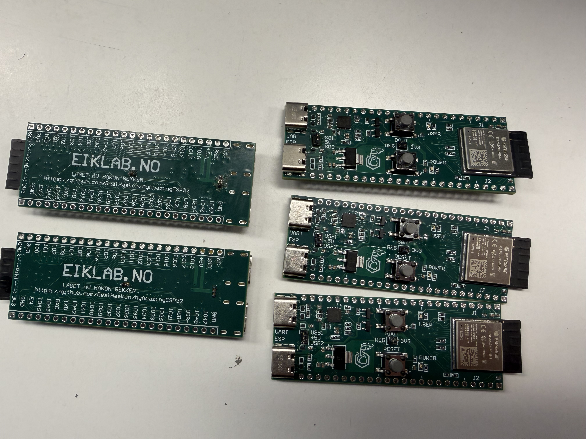
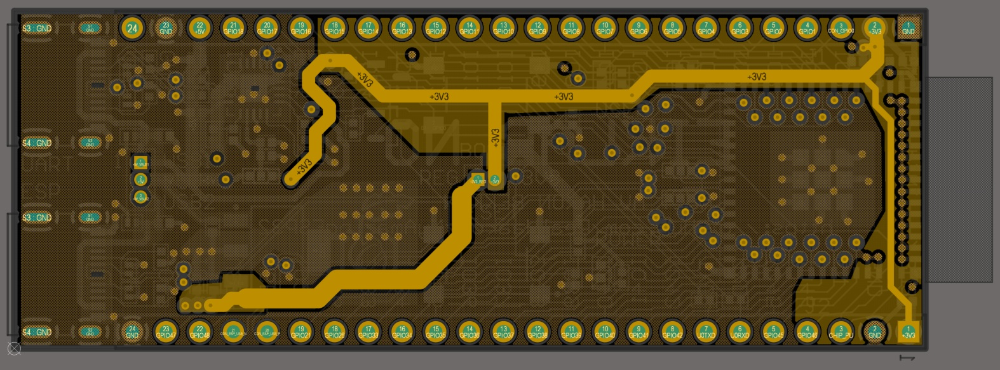
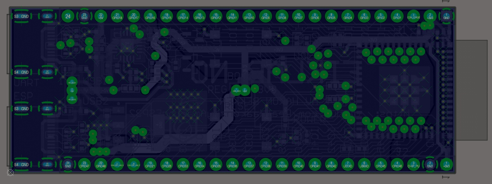
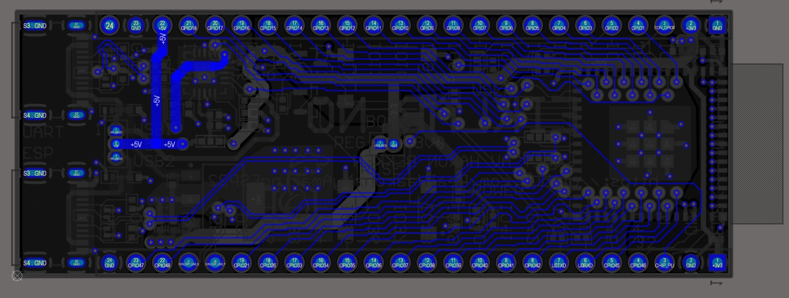

# My Amazing ESP32

A custom ESP32 PCB designed in **Altium Designer**, built as a learning project around a professional PCB workflow — from schematic capture and component choices to layout, manufacturing and bring-up.

The design follows Robert Feranec's Altium Designer tutorial and adapts it into my own ESP32 board. The boards were manufactured and assembled by **JLCPCB**.

> It was a great feeling uploading my code and seeing my ESP32 light up for the very first time and come "to life".

## Project goals

- Learn Altium Designer by working through a complete, real project.
- Practice a professional design workflow: libraries, schematic, layout, DRC checks, fabrication outputs and assembly.
- Take a board from an idea to a working, programmed piece of hardware.

## Repository contents

```text
.
├── ExampleWithWifi/
│   └── wifiserver/
│       └── wifiserver.ino   # ESP32 WiFi web server demo
└── Pictures/
    ├── Demo.gif             # Demonstration of the running web server
    ├── ESP32.jpeg           # Board photo
    ├── ESP32Front.jpg       # Assembled board, front
    ├── ESP32Back.jpg        # Assembled board, back
    └── L1.jpg ... L4.jpg     # Design/layout snapshots
```

## Demo firmware

`ExampleWithWifi/wifiserver/wifiserver.ino` connects the ESP32 to a WiFi network and serves a small, styled web page for controlling the LED on **GPIO 2**.

### Running it

1. Install the **ESP32 Arduino core** (a recent 3.x version is recommended; the sketch uses `NetworkServer`/`NetworkClient`).
2. Open `ExampleWithWifi/wifiserver/wifiserver.ino` in the Arduino IDE.
3. Fill in your network credentials:

   ```cpp
   const char *ssid = "YOUR_WIFI_SSID";
   const char *password = "YOUR_WIFI_PASSWORD";
   ```

4. Select your ESP32 board and port, then upload the sketch.
5. Open the Serial monitor at **115200 baud** to find the board's IP address.
6. Open that address in a browser on the same network.

### Web routes

| Route       | Action                  |
| ----------- | ----------------------- |
| `/`         | Show the LED dashboard  |
| `/H`        | Turn the LED on         |
| `/L`        | Turn the LED off        |
| `/toggle`   | Toggle the LED state    |

The dashboard shows the current state, GPIO level and IP address, with a button that calls the on/off routes from JavaScript.

## Hardware status

The PCB was ordered with assembly from JLCPCB. The board is populated and working; the **connector shunts** are still on order due to a long procurement lead time and will be fitted when they arrive.

## Gallery

### First light




### Design and layout








### Demo


## Reference

- [Robert Feranec — Altium Designer tutorial](https://www.youtube.com/watch?v=KWIzhbQaZZk&t=1567s)

## Notes

This is a personal learning project and a record of the design-to-hardware journey: designing the board in Altium, sending it off for fabrication and assembly, and finally uploading firmware to see it run.
