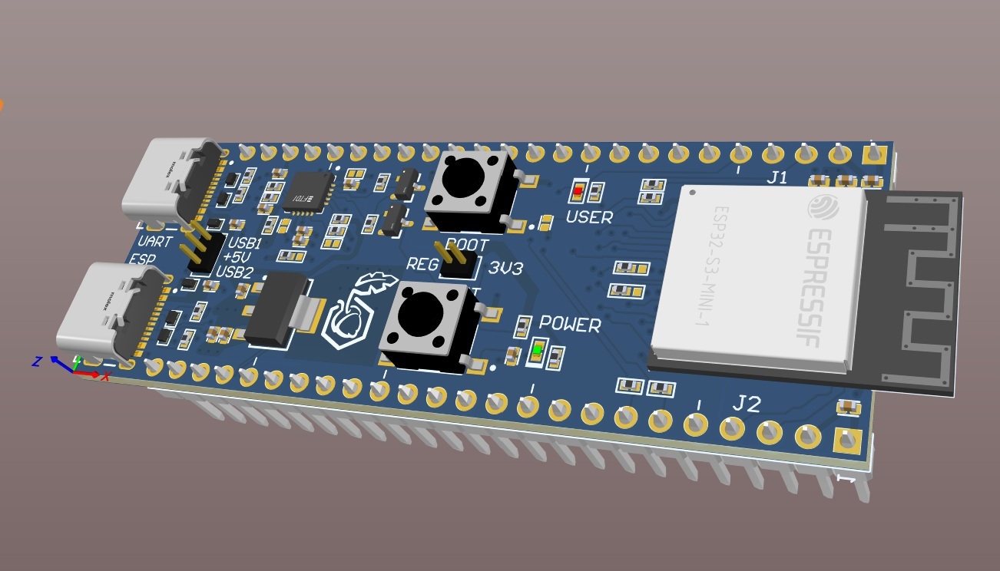
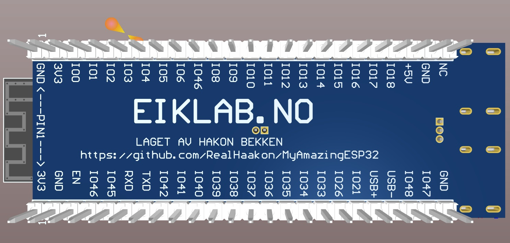
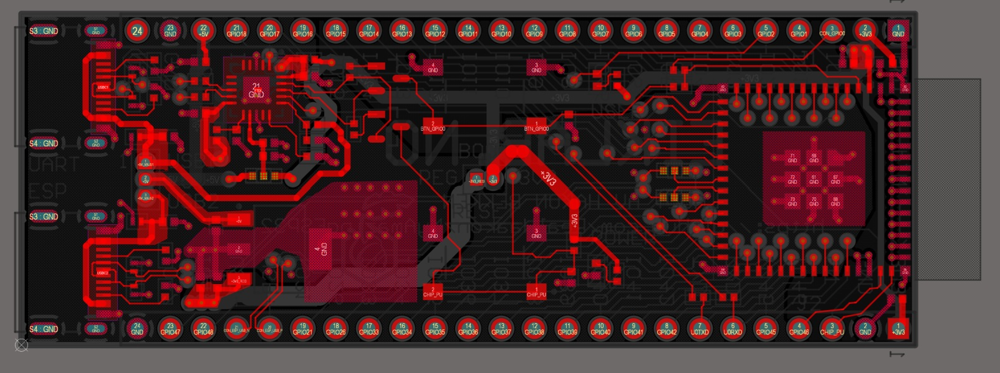
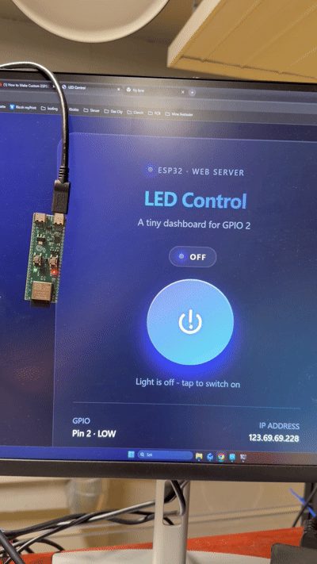

# My Amazing ESP32

A custom ESP32 PCB designed in **Altium Designer**, built as a learning project around a professional PCB workflow — from schematic capture and component choices to layout, manufacturing and bring-up.

The design follows Robert Feranec's Altium Designer tutorial and adapts it into my own ESP32 board. The boards were manufactured and assembled by **JLCPCB**.

> It was a great feeling uploading my code and seeing my ESP32 light up for the very first time and come "to life".

## Project goals

- Learn Altium Designer by working through a complete, real project.
- Practice a professional design workflow: libraries, schematic, layout, DRC checks, fabrication outputs and assembly.
- Take a board from an idea to a working, programmed piece of hardware.

## Hardware status

The PCB was ordered with assembly from JLCPCB. The board is populated and working; the **connector shunts** are still on order due to a long procurement lead time and will be fitted when they arrive.

## Gallery

### First light

### Design and layout

The schematic is available as a [PDF](Pictures/Schematic.pdf).

### Demo

## Acknowledgements

This project would not have been possible without the financing from [Eiklab](https://eiklab.no), a student center for innovation at NMBU. Check them out at [eiklab.no](https://eiklab.no).

## Reference

- [Robert Feranec — Altium Designer tutorial](https://www.youtube.com/watch?v=KWIzhbQaZZk&t=1567s)

## Notes

This is a personal learning project and a record of the design-to-hardware journey: designing the board in Altium, sending it off for fabrication and assembly, and finally uploading firmware to see it run.
